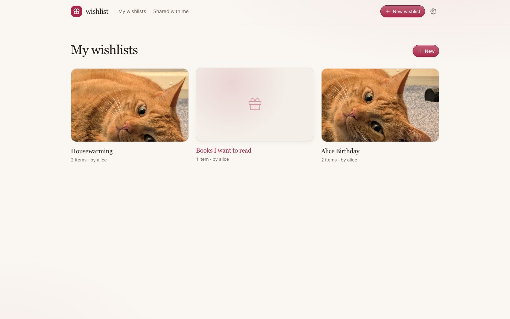
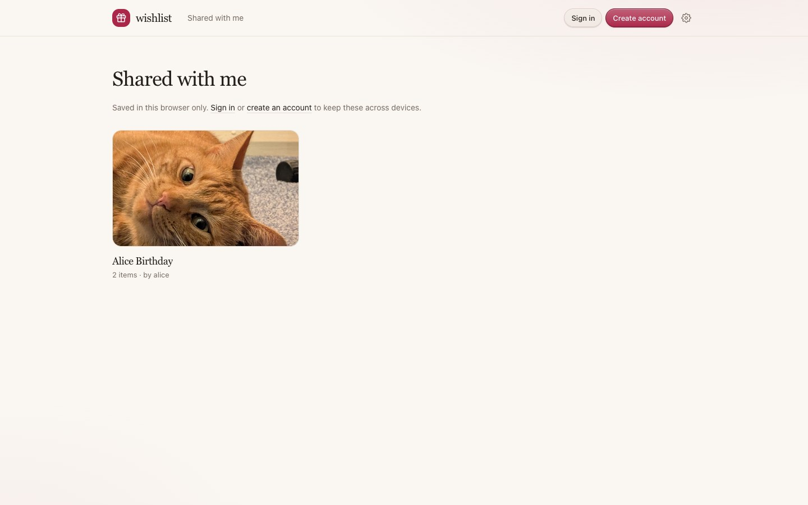
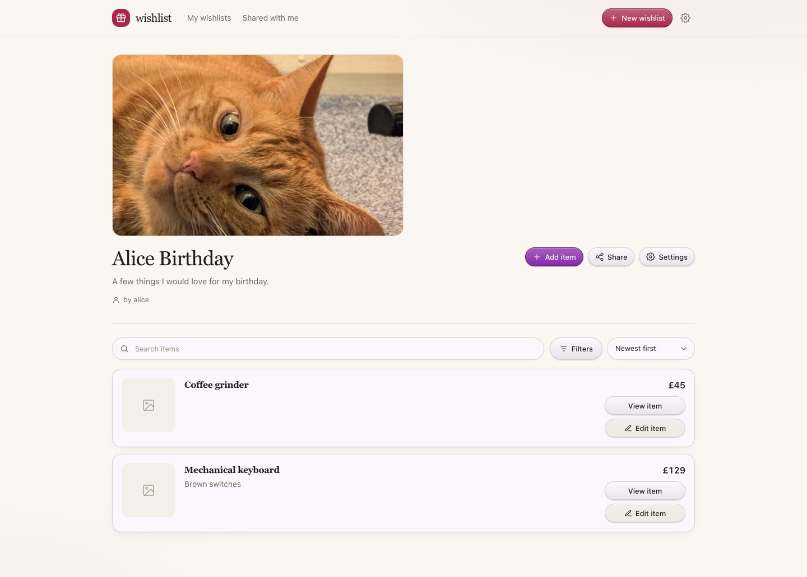
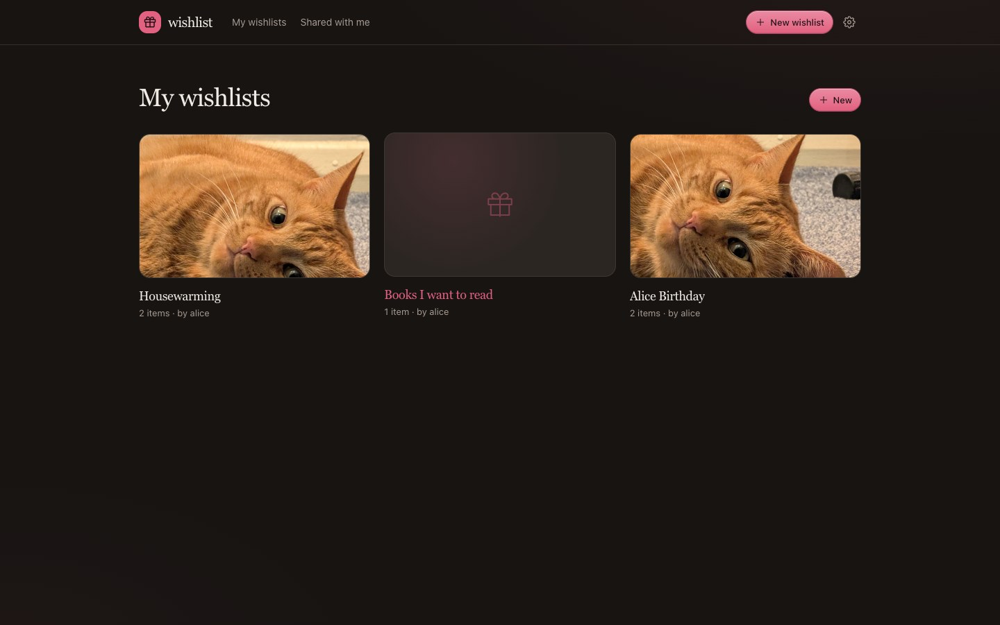
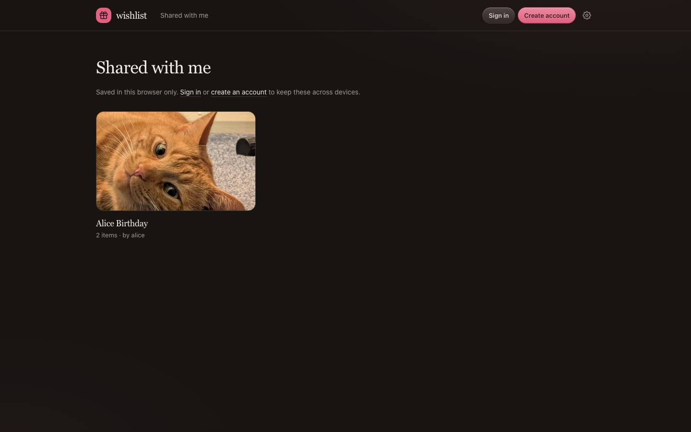
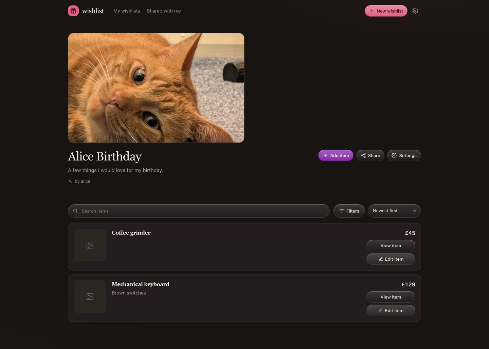

# Wishlist

A small, self-hosted wishlist app. One container, one SQLite database, no external database.

<details>
<summary>Screenshots</summary>

**Light**







**Dark**







</details>

## What's included

- Accounts with persistent sessions and a private set of wishlists. Nothing is published to a central directory.
- Every wishlist has a secret, unguessable link from the moment it is created. Share the link, or share directly with another account as **View only** or **Can edit**.
- Direct shares appear in **Shared with me** immediately and send a notification when the recipient has notifications enabled.
- Wishlist images, descriptions, custom accent colours, optional recurring end dates, item search, price/site filters and sorting.
- Items added from a product link. An on-demand scraper suggests title, description, price and images with available alt/title labels; every suggestion can be selected or ignored before the item is saved.
- Optional official eBay Browse API support, since eBay blocks direct page scraping.
- Approximate display-currency conversions. GBP is the default; guests and signed-in users can choose another currency in Settings. Price filters use the converted value.
- Light, dark or system theme. Guests keep it in a cookie; signed-in users keep it on their account across devices.
- Guest claims with a name, plus a spoiler prompt before a wishlist opens.
- A **Show claimed** filter on wishlists you don't own, with claimed items visible by default.
- Installable PWA with Android share-sheet support. No native Android app is needed.
- Web Push registration, a test notification and direct-share notifications.
- Daily background jobs for price/stock refreshes and exchange rates.
- Link previews with the wishlist photo, title and item count. Wishlist pages are marked `noindex` and are not listed anywhere.

## Quick start

```bash
cp .env.example .env
# Set APP_URL to the address you will visit, e.g. https://wishlist.example.com
docker compose up -d --build
```

Open the app and create the first account. Create a wishlist, then open the **Share** button or **Wishlist settings** to copy its secret link. Send that link to anyone, or add a username directly with view-only or edit access.

The SQLite database and uploaded images live in the `wishlist-data` Docker volume. Uploaded images are served from `/uploads`; no external storage is needed. If you replace the named volume with a bind mount, make sure the container user (UID 1000) can write to it.

### Behind a reverse proxy

Point your proxy at `127.0.0.1:3000` (or the port in `APP_PORT`), terminate HTTPS there, and set `APP_URL=https://your-domain`. Cookies are marked `Secure` automatically when `APP_URL` starts with `https://`. HTTPS is required for installing the PWA and for notifications.

If you expose the container directly, set `APP_PORT` and use `http://server-ip:3000`.

## Using it

- **My wishlists** is the home screen for signed-in users and contains the lists they own. **Shared with me** is a separate page in the header. Guests land on **Shared with me** and can sign in or register from there.
- Every wishlist has a secret link from creation. The link is random and unguessable, and the wishlist is never listed publicly. Anyone with the link can view the list.
- Signed-in users who open a shared link save it to **Shared with me** automatically. Guests save it in their browser instead; a short note explains that those saves are browser-only until they sign in or register, and they move into the account when they do.
- Direct shares can be **View only** or **Can edit**. Viewers can open the list and claim items. Editors can also add and edit items. Only the owner can change wishlist details, manage shares or delete the wishlist.
- If the recipient has notifications enabled, sharing a wishlist with them sends a notification with the wishlist link.
- On the first visit to a wishlist, guests are asked whether it belongs to them. Owners get a spoiler-free view; buyers see claims.
- Claiming an item requires a name so other guests know it has been bought. Claims are atomic: two people cannot claim the same item.
- On wishlists you do not own, **Show claimed** toggles bought items in or out of the list. It defaults to on and is hidden on your own wishlists.
- Item descriptions are replaced on the card by a custom note when one exists. **View item** opens the full note, description and a link to the original page.

### Upgrading from an earlier version

Wishlist links now use a secret slug instead of the numeric ID, so old `/w/<number>` URLs stop working after the database migration. Open each wishlist you still need to share and copy its new link from the wishlist page or **Wishlist settings**. Existing collaborators are migrated to **Can edit** direct shares.

## Configuration

Copy `.env.example` to `.env`. Compose reads it automatically.

| Variable | Default | Purpose |
| --- | --- | --- |
| `APP_URL` | `http://localhost:3000` | Public URL used in share links and link previews. |
| `APP_PORT` | `3000` | Host port published by Compose. |
| `COOKIE_SECURE` | derived from `APP_URL` | Force `Secure` cookies on or off. |
| `ALLOW_REGISTRATION` | `true` | Set to `false` after creating your accounts to close sign-ups. |
| `TZ` | system | Timezone used for the end dates and the scrape schedule. |
| `DEFAULT_CURRENCY` | `GBP` | Currency used when no currency is found on a scraped item. |
| `FX_CRON` | `0 0 * * *` | Five-field cron expression for the daily exchange-rate refresh. |
| `SCRAPE_ENABLED` | `true` | Enable the scheduled price/stock refresh. |
| `SCRAPE_CRON` | `0 0 * * *` | Five-field cron expression, checked in `TZ`. |
| `SCRAPE_HEADLESS` | `auto` | On-demand scraper: `auto`, `always` or `never` use Chromium. |
| `SCRAPE_JOBS_HEADLESS` | `false` | Allow scheduled refreshes to use Chromium. Heavier. |
| `SCRAPE_MAX_PER_RUN` | `1000` | Maximum items checked per run; `0` means no limit. |
| `SCRAPE_DELAY_MS` | `2500` | Delay between requests. |
| `SCRAPE_DOMAIN_DELAY_MS` | `15000` | Minimum delay between requests to the same domain. |
| `CHROMIUM_PATH` | set by the image | Optional path to a Chromium binary for scraper fallback. |
| `EBAY_CLIENT_ID` | empty | Optional eBay Browse API Client ID. |
| `EBAY_CLIENT_SECRET` | empty | Optional eBay Browse API Client Secret. |
| `EBAY_MARKETPLACE_ID` | derived from the URL | Optional override such as `EBAY_GB` or `EBAY_US`. |
| `VAPID_PUBLIC_KEY` / `VAPID_PRIVATE_KEY` | auto-generated | Web Push keys. Generated once and stored in the database if omitted. |
| `VAPID_SUBJECT` | `APP_URL` | Contact string for push services. Use a `mailto:` address if possible. |

## Scraper

Pasting a link never scrapes automatically. Press **Fetch details** to try. The scraper first uses a normal HTTP request with a browser user agent and reads JSON-LD, Open Graph, microdata and visible price fields. In `auto` mode it falls back to headless Chromium when the page is blocked or has no usable product data.

Some shops block data-centre IPs or require a login; in those cases the app shows an error and keeps **Manually input details** available. The container includes Chromium but it is only launched on demand. Keep `SCRAPE_JOBS_HEADLESS=false` unless scheduled checks really need a browser.

When images are extracted, the picker also shows their title/alt text when the page provides it, falling back to a readable filename.

### eBay

eBay blocks direct page requests with bot protection. The app therefore does not try to scrape eBay HTML. Instead, add the optional official eBay Browse API credentials:

1. Create an application keyset in the [eBay Developers Program](https://developer.ebay.com/).
2. Put its Client ID and Client Secret in `.env` as `EBAY_CLIENT_ID` and `EBAY_CLIENT_SECRET`.
3. Restart the app. The marketplace is derived from the eBay URL (e.g. `ebay.co.uk` → `EBAY_GB`); set `EBAY_MARKETPLACE_ID` to override it.

Without these credentials, eBay links show a clear error and fall back to manual entry. The Browse API uses eBay's application access token and is subject to eBay's own API limits.

The scraper accepts only standard HTTP/HTTPS URLs on public addresses, limits response size and redirects, and rate-limits requests.

## Currency

Prices are always stored in the currency found on the item page. The app shows the original price plus an approximate converted value when the item currency differs from your display currency. GBP is the default; the choice is in **Settings**, either for a signed-in account or for a guest device. Price filters and price sorting use the converted amount.

Exchange rates are fetched from the free [Frankfurter](https://frankfurter.dev) API (ECB data), stored in SQLite and refreshed by a daily background job. Conversion is approximate by design. If the rates service is unavailable, existing rates are kept and the app continues to work without converted values.

## Price, stock and exchange-rate refresh

The scheduler is built into the app and starts at midnight by default. It checks every unclaimed item with a link, one at a time with per-domain delays, and updates the stored price and availability when the page exposes them. Claimed items are skipped because they have already been bought. A separate scheduled task refreshes the exchange rates; both run daily by default, even if price checks are disabled.

On a large list the first run may take a while; use `SCRAPE_MAX_PER_RUN` to cap it. This setup is intended for a single app instance. Do not run multiple replicas, otherwise each one will schedule its own refresh.

## PWA and notifications

On Android, open the site in Chrome and choose **Install app** or **Add to Home screen**. Once installed, sharing a link from another app shows **Wishlist** in the share sheet. The link opens the add-item flow for your default wishlist, or a wishlist picker if none is set. The default wishlist is configured in **Settings**.

iOS can install the PWA, but iOS does not support web share targets, so the share-sheet shortcut is Android-only. No native app is required or included.

Enable notifications per device in **Settings → Notifications**. The switch registers the service worker and stores a push subscription. A test notification is available. When another account shares a wishlist with you directly, the app sends a notification with a link to it, provided notifications are enabled for your account.

## Backups

Everything is in `/data` inside the container: `wishlist.db`, `wishlist.db-wal`, `wishlist.db-shm` and the `uploads/` folder.

```bash
docker compose stop app
docker run --rm \
  -v wishlist_wishlist-data:/data \
  -v "$PWD":/backup \
  alpine tar czf /backup/wishlist-backup.tgz -C /data .
docker compose start app
```

Restore with the same command in reverse while the app is stopped.

## Deploying with Docker on your server

The GitHub Actions workflow builds multi-architecture (`linux/amd64` and `linux/arm64`) images and publishes them to `ghcr.io/joelis10/wishlist`.

On the server:

```bash
git clone https://github.com/joelis10/wishlist.git
cd wishlist
cp .env.example .env
# Set APP_URL to your real public URL
# Optionally set APP_PORT, TZ, etc.

docker compose pull
docker compose up -d --no-build
```

The compose file defaults to the published `ghcr.io/joelis10/wishlist:latest` image. To update later:

```bash
git pull
docker compose pull
docker compose up -d --no-build
```

If you prefer to build on the server instead of pulling, use `docker compose up -d --build` (the Dockerfile is in the same repository).

This repository is public, so GitHub Actions builds and the GHCR image are free. Keep the image package public in GitHub to allow anonymous pulls. On a private fork, either make the package public or log the server into `ghcr.io` with a token that has `read:packages`.

## Local development

Node 24 is required because the app uses the built-in `node:sqlite` module.

```bash
npm install
DATA_DIR=./data APP_URL=http://localhost:3000 npm run dev
npm test
npm run build
```

Icons and the default share image are generated into `public/` by `npm run assets`. They are committed, so this is only needed if you change the artwork.

## Limits

- 1,000 items per wishlist.
- Images are resized to 1600 × 1000 JPEG; uploads are limited to 8 MB.
- One app container. SQLite and the in-process scheduler are chosen for a small self-hosted deployment, not for horizontal scaling.
